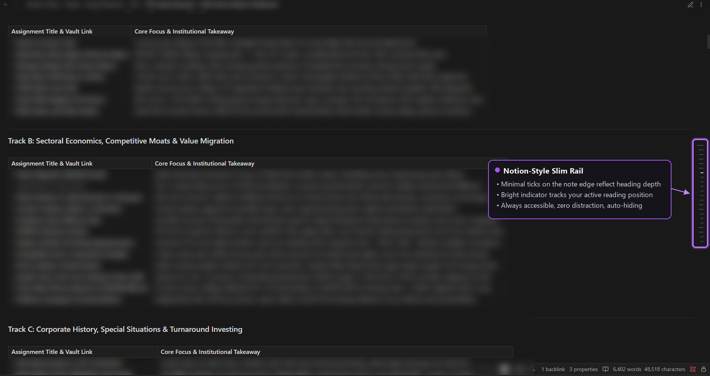
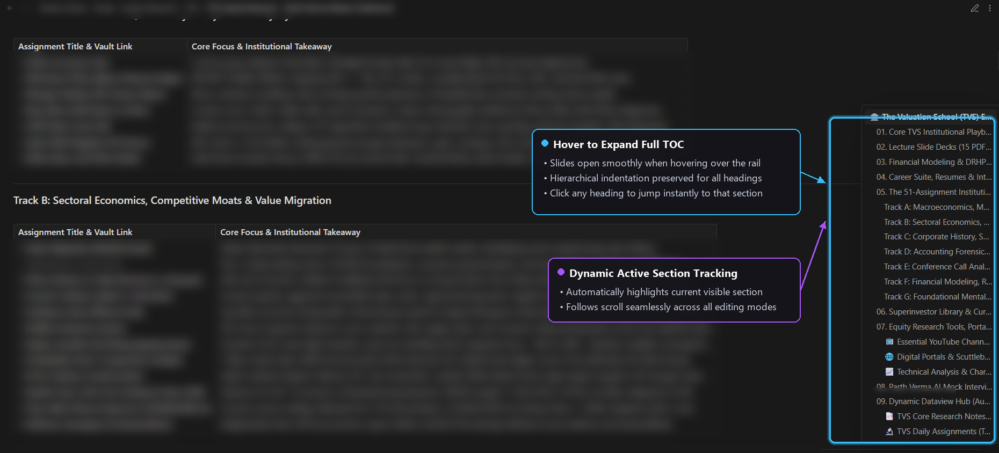

# Notion TOC for Obsidian

[](https://obsidian.md)
[](https://github.com/tanishdt/obsidian-notion-toc/releases)
[](LICENSE)
[](#compatibility)
[](https://tanishdt.github.io/obsidian-notion-toc/)

> A sleek, zero-clutter, Notion-style table of contents rail for Obsidian notes.

A slim rail of ticks sits quietly on the right edge of your note. Tick length reflects heading depth, and the tick for the section you're reading dynamically illuminates. Hover over the rail, and a responsive sidebar slides out showing the full outline with nested indentation. Click any item to jump instantly.

---

## 📸 Visual Overview

### 1. Minimal Tick Rail (Reading Mode)
A distraction-free rail on the far right edge showing your outline structure and scroll position at a glance.



### 2. Smooth Hover Sidebar (Interactive Navigation)
Hover over the rail to smoothly expand the full table of contents with hierarchy, active section highlight, and single-click jumping.



---

## ✨ Features

- 🌊 **Smooth scroll gliding (v2)**: Clicking any heading or rail tick glides smoothly into view with an organic cubic ease-out curve. Animation duration dynamically adapts to hop distance, and any user scroll gesture (wheel, touch, or key) immediately cancels the glide.
- 🎯 **Always visible, never in the way**: A minimalist tick rail pinned to the right edge. Ticks indicate relative heading levels (H1–H6) without consuming workspace width.
- ⚡ **Hover to expand**: Hover anywhere on the rail to reveal the full table of contents sidebar.
- 📍 **Live active section**: Real-time position tracking illuminates your current reading section on both the rail and the expanded sidebar.
- 🚀 **Click-to-jump**: Instant smooth navigation to any heading from either the rail ticks or sidebar entries.
- 📝 **Works in all view modes**: Seamless across Reading view, Live Preview, and Source mode. Automatically updates as you type.
- 🌲 **Clean hierarchy handling**: Handles skipped levels gracefully (e.g. an H1 followed directly by an H3 indents cleanly without phantom whitespace).
- 🧼 **Markdown & Wikilink stripping**: Strips raw markdown syntax, HTML tags, highlights, and wikilinks so heading labels stay clean and legible.
- 🎨 **Adaptive Obsidian theming**: Inherits native CSS variables to automatically match your light or dark theme and custom accent colors.
- 📱 **Mobile & tablet ready**: Tap the rail on mobile to open the sidebar, tap outside to dismiss.
- 🖨️ **Print & export safe**: Automatically suppressed when printing or exporting notes to PDF.

---

## 📥 Installation

### Method 1: Obsidian Community Plugins (Upcoming)
1. Open Obsidian **Settings** (`⚙`) → **Community plugins**.
2. Make sure **Restricted mode** is turned off.
3. Search for **Notion TOC** and click **Install**, then **Enable**.

### Method 2: Via BRAT (Recommended for immediate updates)
1. Install the [Obsidian42 - BRAT](https://github.com/TfTHacker/obsidian42-brat) plugin from Community Plugins.
2. In Obsidian, open the Command Palette (<kbd>Ctrl</kbd>/<kbd>Cmd</kbd> + <kbd>P</kbd>) and run:
   ```text
   BRAT: Add a beta plugin for testing
   ```
3. Enter the repository URL:
   ```text
   https://github.com/tanishdt/obsidian-notion-toc
   ```
4. Click **Add Plugin**, then enable **Notion TOC** under Settings → Community plugins.

### Method 3: Manual Installation
1. Download `manifest.json`, `main.js`, and `styles.css` from the [Latest Release](https://github.com/tanishdt/obsidian-notion-toc/releases/latest).
2. Inside your Obsidian vault, navigate to `.obsidian/plugins/` (create the folder if it doesn't exist).
3. Create a folder named `notion-toc` and paste the three downloaded files inside:
   ```text
   YourVault/
   └── .obsidian/
       └── plugins/
           └── notion-toc/
               ├── main.js
               ├── manifest.json
               └── styles.css
   ```
4. Restart Obsidian (or click the reload icon in Community plugins) and toggle **Notion TOC** on.

---

## 🎮 Usage & Controls

| Action | Result |
| :--- | :--- |
| **Hover right rail** | Slides open the table of contents sidebar |
| **Click any tick or heading** | Instantly scrolls the note to that section |
| **Move pointer away** | Sidebar closes automatically after a configurable delay |
| **Command Palette: `Toggle table of contents rail`** | Quick toggle to show or hide the rail |
| **Tap rail (Mobile)** | Opens the sidebar |
| **Tap backdrop (Mobile)** | Closes the sidebar |

---

## ⚙️ Settings

Customize Notion TOC from **Settings → Community plugins → Notion TOC**:

| Setting | Default | Description |
| :--- | :---: | :--- |
| **Enable table of contents** | `true` | Toggle the rail visibility across your vault. |
| **Minimum headings** | `1` | Automatically hide the rail on short notes with fewer headings than this threshold. |
| **Deepest heading level** | `6` | Exclude deeper headings (e.g. limit to H1–H3 for high-level summaries). |
| **Sidebar width** | `260px` | Customize the flyout sidebar width. |
| **Distance from right edge** | `14px` | Adjust rail offset (useful if you use a wide custom scrollbar). |
| **Close delay** | `250ms` | Buffer time before the flyout dismisses after the mouse leaves. |
| **Smooth scroll duration** | `400ms` | Maximum glide time to a clicked heading (0–1000ms). Set to `0` to jump instantly. |

---

## 🛠️ How It Works

- **Metadata-Driven**: Listens directly to Obsidian's fast `MetadataCache` API, keeping headings synced with zero document re-parsing overhead.
- **Scroll Synchronized**: Reads coordinates via the active view's viewport scroll API to maintain accurate active-heading tracking in both Live Preview and Reading views.
- **Pure JavaScript**: Built with standard TypeScript/JavaScript, zero heavy runtime dependencies, and negligible memory footprint.

---

## 🗺️ Roadmap

- [ ] Left-edge rail placement option
- [ ] Collapsible parent heading trees within the sidebar
- [ ] Optional pin mode to keep the sidebar permanently expanded
- [ ] Frontmatter flag (`notion-toc: false`) for per-note disabling

---

## 🤝 Contributing

Contributions, bug reports, and suggestions are welcome!

1. Fork the repository
2. Create your branch (`git checkout -b feature/amazing-feature`)
3. Commit your changes (`git commit -m 'Add amazing feature'`)
4. Push to the branch (`git push origin feature/amazing-feature`)
5. Open a Pull Request

---

## 👤 Author

Crafted by **[Tanish Vijay](https://tanish.digital)**
- GitHub: [@tanishdt](https://github.com/tanishdt)
- Portfolio: [tanish.digital](https://tanish.digital)

---

## 📄 License

This project is open-source and licensed under the [MIT License](LICENSE).
